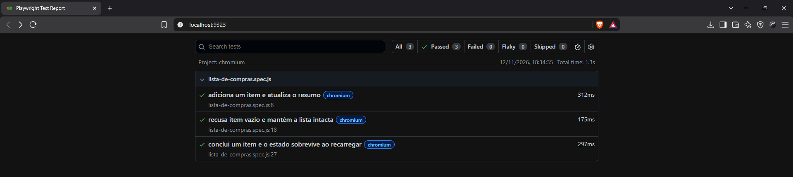
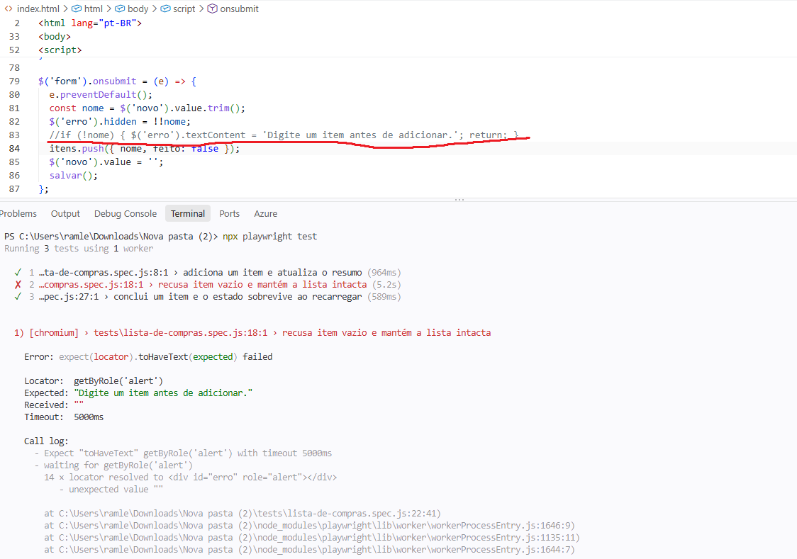
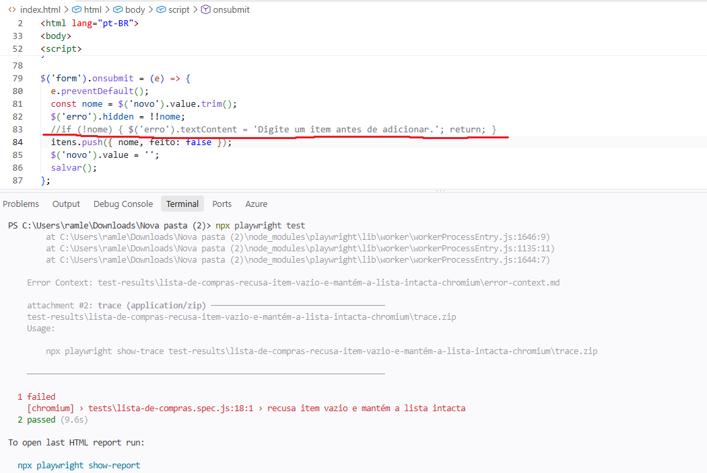
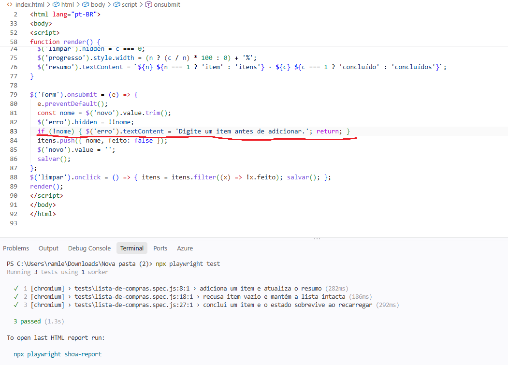

# Aceitação · Lista de compras

- **Integrante:** João Paulo de Deus Natividade Oliveira Saraiva
- **Como rodar:** `npm i && npx playwright install chromium && npx playwright test`
- **Relatório:** `npx playwright show-report` (pasta `playwright-report/`)

## Critério → teste → evidência

| Critério | Teste (arquivo:linha) | O que prova | Evidência |
|---|---|---|---|
| C1 · Adicionar item (caminho principal) | `tests/lista-de-compras.spec.js:8` | Digitar "Café" e clicar em Adicionar mostra o item na lista e o resumo "1 item · 0 concluídos" | [relatorio-3-verdes.png](evidencias/relatorio-3-verdes.png) |
| C2 · Recusar item vazio (regra de erro) | `tests/lista-de-compras.spec.js:18` | Só espaços exibem o alerta "Digite um item antes de adicionar." e a lista continua vazia | [relatorio-3-verdes.png](evidencias/relatorio-3-verdes.png) |
| C3 · Concluir e persistir (regra de estado) | `tests/lista-de-compras.spec.js:27` | O item marcado continua marcado após `reload` e o resumo mostra "1 item · 1 concluído" | [relatorio-3-verdes.png](evidencias/relatorio-3-verdes.png) |

## Anti-teste (quebrei o app de propósito)

| Regra quebrada | Teste que ficou vermelho | Print vermelho | Print verde (depois de desfazer) |
|---|---|---|---|
| Comentei a validação `if (!nome)` (linha 83 do `index.html`) | C2 | [c2-vermelho.png](evidencias/c2-vermelho.png) e [c2-vermelho_1.png](evidencias/c2-vermelho_1.png) | [c2-verde.png](evidencias/c2-verde.png) |

## Prints

**Relatório com os 3 testes verdes**

**C2 com a validação removida (vermelho)**

**C2 depois de desfazer a quebra (verde)**

